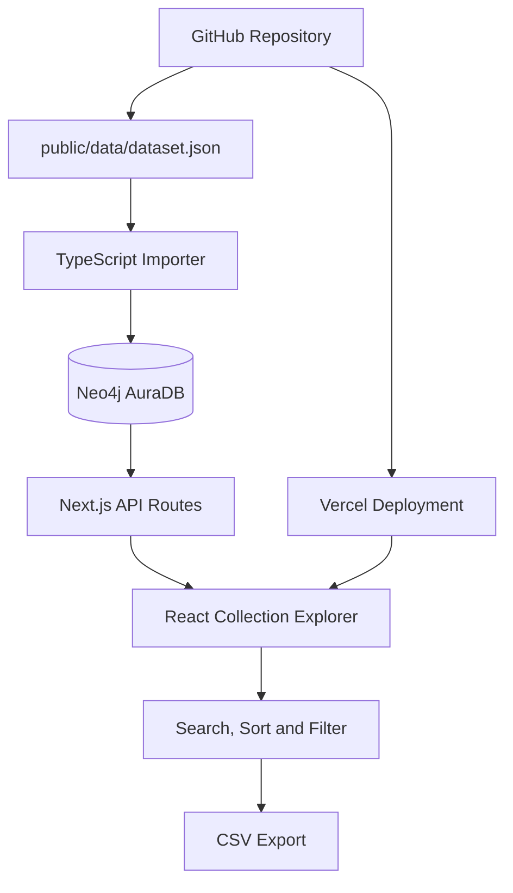
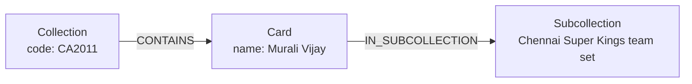

# TCGNow — Trading Card Archive

**A database-powered archive for exploring, searching, and organising trading card collections.**

TCGNow is a web application built to make trading card collection data easier to browse and analyse. Instead of relying entirely on a hardcoded catalogue, it uses **Neo4j** to store cards, collections, and their relationships, while a Next.js interface provides searchable, sortable tables.

The project also demonstrates graph database modelling, database querying, API development, and the foundations of automated data synchronisation.

---

## ✨ Features

- **Collection Explorer** — Browse card records from the database by collection.
- **Year and Season Filtering** — Narrow down collections using their detected year or season.
- **Search** — Search loaded card records by card name and other displayed attributes.
- **Sortable Tables** — Sort records by serial number, card name, rarity, and other columns.
- **Customisable Columns** — Show or hide table columns to suit the information being examined.
- **CSV Export** — Export the filtered records and currently visible columns.
- **Paginated Results** — Navigate large collections in manageable pages.
- **Graph Database** — Represent cards, collections, and subcollections as connected Neo4j nodes.
- **API-Driven Data** — Retrieve collections and card records through Next.js API routes.
- **Automated Import Workflow** — The project includes an importer designed to load JSON card data into Neo4j.

---

## 🖥️ Technology Stack

| Technology | Purpose |
|---|---|
| Next.js 16 | Application framework and API routes |
| React 19 | Interactive user interface |
| TypeScript | Type-safe application code |
| Tailwind CSS 4 | Styling foundation |
| GSAP | Interface and table animations |
| Lucide React | Interface icons |
| Neo4j AuraDB | Hosted graph database |
| Cypher | Graph queries and relationship traversal |
| `neo4j-driver` | Connects the application and importer to Neo4j |
| `tsx` | Executes the TypeScript data-import script |
| GitHub | Source control and dataset versioning |
| Vercel | Application deployment |

---

## 🏗️ Architecture



### How it works

1. Card information is maintained in `public/data/dataset.json`.
2. `scripts/import-cards.ts` reads the JSON records and imports them into Neo4j.
3. Neo4j stores cards and connects them to collections and subcollections.
4. The `/api/collections` endpoint retrieves available collections and their card counts.
5. The `/api/cards` endpoint retrieves matching card records, with optional filtering, search, and pagination parameters.
6. The React interface presents the returned records in an interactive table.

The JSON file remains the source dataset, while Neo4j provides the database structure used by the application.

---

## 🕸️ Graph Data Model

TCGNow uses three principal node types.

| Node | Purpose | Example properties |
|---|---|---|
| `Card` | Represents an individual card record | `id`, `sno`, `name`, `type`, `rarity`, `image` |
| `Collection` | Represents a card collection | `code` |
| `Subcollection` | Groups related cards | `name` |

### Relationships

- `(Collection)-[:CONTAINS]->(Card)`
- `(Card)-[:IN_SUBCOLLECTION]->(Subcollection)`

A card is identified by an ID constructed from its collection code and serial number. Unique constraints help prevent duplicate nodes with the same identifier.

### Graph representation



This model makes it possible to retrieve cards by collection, explore their groupings, and combine information across connected nodes.

---

## 🗃️ Database Query Examples

The application uses Cypher, Neo4j's query language. In Cypher, `MATCH` patterns are used to find connected records. A required match behaves much like an **INNER JOIN** in a relational database: only records satisfying the specified patterns are returned.

### 1. Retrieve cards from a collection

```cypher
MATCH (collection:Collection)-[:CONTAINS]->(card:Card)
WHERE collection.code = 'CA2011'
RETURN collection.code AS collection,
       card.sno AS serialNumber,
       card.name AS cardName,
       card.rarity AS rarity
ORDER BY card.sno;
```

### 2. Demonstrate an INNER JOIN equivalent

The following query matches cards that have both a collection relationship and a subcollection relationship. Cards that do not satisfy both patterns are excluded.

```cypher
MATCH (collection:Collection)-[:CONTAINS]->(card:Card)
MATCH (card)-[:IN_SUBCOLLECTION]->(sub:Subcollection)
RETURN collection.code AS collection,
       card.name AS cardName,
       sub.name AS subcollection
ORDER BY collection, card.name;
```

**Relational interpretation:** this is conceptually similar to joining `Collection`, `Card`, and `Subcollection` tables using their relationships or foreign keys. The `MATCH` clauses are required matches, so a card without either required relationship will not appear in the result.

### 3. Count cards in each collection

```cypher
MATCH (collection:Collection)-[:CONTAINS]->(card:Card)
RETURN collection.code AS collection,
       count(card) AS cardCount
ORDER BY collection;
```

### 4. Search card names

```cypher
MATCH (card:Card)
WHERE toLower(card.name) CONTAINS toLower('Murali')
RETURN card.id AS id,
       card.name AS cardName,
       card.type AS type,
       card.rarity AS rarity
ORDER BY card.name;
```

### 5. Find cards by subcollection

```cypher
MATCH (card:Card)-[:IN_SUBCOLLECTION]->(sub:Subcollection)
WHERE sub.name = 'Chennai Super Kings team set'
RETURN card.name AS cardName,
       card.type AS type,
       card.rarity AS rarity
ORDER BY card.name;
```

---

## 🔌 API Endpoints

### `GET /api/collections`

Returns collections found in Neo4j, together with the number of connected cards.

Example response:

```json
{
  "collections": [
    {
      "code": "CA2011",
      "cardCount": 199
    }
  ]
}
```

The count shown here is illustrative of the current application state; the endpoint calculates its response from the database at request time.

### `GET /api/cards`

Returns card records and supports query parameters for filtering and pagination.

| Parameter | Purpose |
|---|---|
| `collection` | Filter by collection code |
| `subcollection` | Filter by subcollection name |
| `search` | Search card name, type, or rarity |
| `limit` | Maximum records returned per request, capped at 200 |
| `offset` | Number of records to skip |

Example:

```text
/api/cards?collection=CA2011&limit=100&offset=0
```

Example search:

```text
/api/cards?search=Murali&limit=50&offset=0
```

---

## 🚀 Run Locally

### Requirements

- Node.js 22
- npm
- A Neo4j database with connection credentials

### 1. Clone the repository

```bash
git clone https://github.com/Aryankpoor/tcgnow.git
cd tcgnow
```

### 2. Install dependencies

```bash
npm ci
```

### 3. Configure the database connection

Create `.env.local` in the project root with the following variables, using the connection details for your Neo4j AuraDB instance:

```dotenv
NEO4J_URI=neo4j+s://your-instance.databases.neo4j.io
NEO4J_USERNAME=neo4j
NEO4J_PASSWORD=your-database-password
NEO4J_DATABASE=2074fd09
```

Keep the actual password private. The example URI illustrates the expected format; use the URI provided by your own Neo4j instance.

### 4. Import the card dataset

```bash
npm run import:cards
```

The importer reads `public/data/dataset.json`, creates the required uniqueness constraints if they do not already exist, and merges card, collection, and subcollection nodes and relationships.

The importer performs an **upsert**: it creates missing records and updates matching records. It does not currently delete database records that have been removed from the JSON file.

### 5. Start the development server

```bash
npm run dev
```

Open [http://localhost:3000](http://localhost:3000).

### 6. Check the production build

```bash
npm run build
```

---

## ☁️ Deployment

The application can be deployed on Vercel and connected to Neo4j AuraDB.

Configure these environment variables in the Vercel project settings:

- `NEO4J_URI`
- `NEO4J_USERNAME`
- `NEO4J_PASSWORD`
- `NEO4J_DATABASE`

Use the same database name as the one configured locally. Redeploy after changing environment variables.

The browser-facing interface communicates with Next.js API routes; the Neo4j credentials must remain server-side and must never be exposed through `NEXT_PUBLIC_` variables.

---

## 🔄 Data Import and Synchronisation

The importer currently reads the version-controlled JSON dataset and upserts its records into Neo4j.

A GitHub Actions workflow can run this importer when the dataset or importer changes. To use such a workflow, configure the database credentials as repository Actions secrets and run the workflow against the intended branch.

Because the current import is an upsert rather than a complete mirror, removing a record from the JSON file does not automatically remove it from Neo4j. Any future deletion reconciliation should be implemented carefully so that records are not removed accidentally.

---

## 📁 Project Structure

```text
tcgnow/
├── app/
│   ├── api/
│   │   ├── cards/
│   │   │   └── route.ts
│   │   └── collections/
│   │       └── route.ts
│   ├── layout.tsx
│   └── page.tsx
├── components/
│   └── collection-explorer.tsx
├── lib/
│   └── neo4j.ts
├── public/
│   └── data/
│       └── dataset.json
├── scripts/
│   └── import-cards.ts
├── .env.local
├── package.json
└── README.md
```

`.env.local` contains local credentials and should remain excluded from version control.

---

## 🧪 Testing and Validation

Useful checks during development:

```bash
npm run lint
npm run build
npm run import:cards
```

You can also validate the database directly in Neo4j Browser:

```cypher
MATCH (c:Card)
RETURN count(c) AS totalCards;
```

```cypher
MATCH (collection:Collection)
RETURN collection.code AS collection
ORDER BY collection;
```

```cypher
MATCH (card:Card)-[:IN_SUBCOLLECTION]->(sub:Subcollection)
RETURN sub.name AS subcollection,
       count(card) AS cardCount
ORDER BY cardCount DESC;
```

---

## 🛣️ Potential Improvements

- Add a global Card Explorer to find every occurrence of a card name across collections.
- Add explicit sport metadata to collections for reliable Cricket, Football, and WWE filtering.
- Introduce safe synchronisation that handles removed records as well as new and updated records.
- Add richer card previews and image links.
- Add tests for API filtering, pagination, and database responses.
- Expand the graph with additional entities and relationships where the dataset supports them.

---

## 📄 License and Data

TCGNow is a personal software project. The repository contains the application's code and the card dataset used by the importer. No separate open-source license is specified here; reuse of the code or data should not be assumed to be unrestricted.

---

**TCGNow — explore the cards, understand the connections, and keep the collection organised.**
